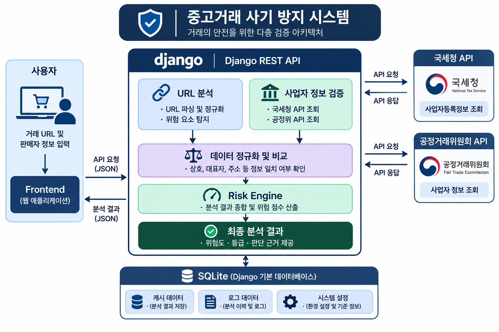

# WOOWANGTHON_TEAM_25_BE

Django REST Framework의 `POST /api/v1/scan/`입니다. v0.5.0부터 사업자 확인 최대 50점과 검증된 문구 분석 최대 50점을 합산해 반환합니다. 같은 사이트의 보상·수익 표시·출금 제한·별도 입금 요구를 연결하고, 직접 입금 조건은 이전 단계 기록 없이도 경고합니다.

## GitHub main 통합

이 작업본은 GitHub [`main`의 1cc0344](https://github.com/woowangthon/WOOWANGTHON_TEAM_25_BE/commit/1cc0344d3cc22785fab53b129bc0e48586397b59)를 이전 AI 작업본과 통합했습니다. 기준 로컬 커밋 이후 10개 커밋의 변경을 비교했습니다. 공정위 상호의 쉼표 정규화, 복수 대표자 비교, 영문명 괄호 안 한글명 정규화, ScanCache 모델·초기 마이그레이션과 갱신된 아키텍처 이미지를 반영했습니다. 로컬의 선택 안내문·출처 검증·단계 기록·AI 점수 응답과 민감 정보 로그 제외는 유지했습니다. 통합 ZIP 루트의 `MERGE_NOTES.json`에 기준과 처리 내용을 기록합니다. GitHub 쓰기는 하지 않았습니다.

아래는 `main`에 포함된 원본 아키텍처입니다. 현재 AI·50/50 점수 응답의 구체적인 계약은 아래 설명을 따릅니다.



기술 구성은 Python, Django REST Framework, Docker이며, 실제 배포 시에는 운영용 서버 구성이 필요합니다.

## 실행과 환경변수

```sh
python -m venv .venv
.venv/bin/python -m pip install -r requirements.txt
.venv/bin/python app/manage.py migrate
.venv/bin/python app/manage.py runserver 127.0.0.1:8000
```

Windows Python 경로는 `.venv\Scripts\python.exe`입니다. OpenAI 키는 서버 환경변수 `OPENAI_API_KEY`에서 읽으며, `OPENAI_MODEL` 기본값은 `gpt-6-luna`입니다. 키를 요청 본문·코드·로그에 넣지 않습니다. 통합 배포본의 공공 API 키·Django 환경변수 설정과 Windows 실행 순서는 상위 `START_HERE.txt`를 따르세요. 원본 공공 API 클라이언트 설정을 자동으로 변경하는 기능은 이 API에 없습니다.

## 요청

```json
{
  "url": "https://shop.example.com/withdraw",
  "business_info": {"business_name": "예시상점"},
  "page_context": "세금 납부가 확인되면 수익금을 받을 수 있습니다.",
  "page_observations": [
    {
      "id": "obs_tax_policy",
      "source_url": "https://shop.example.com/guide",
      "kind": "linked_policy",
      "text": "세금 납부가 확인되면 수익금을 받을 수 있습니다.",
      "observed_at": "2026-11-14T12:00:00Z"
    }
  ]
}
```

- `url`: 필수 HTTP(S) URL. URL의 인증 정보는 허용하지 않습니다.
- `business_info`: 기존 선택 사업자정보 객체. `displayed_business_number`는 화면에서 읽은 번호 원문의 선택 문자열(최대 40자)입니다. 프런트엔드는 번호 형식이 잘못된 경우 이 값을 보내며, 단순 오류 플래그만으로 가점하지 않습니다. 정규 `business_number`와 숫자 값/형식이 충돌하면 HTTP 400입니다.
- `page_context`: 기존 선택 문자열, 최대 2,000자. 생략·빈 문자열을 허용합니다.
- `page_observations`: 선택 배열, 최대 10개. 각 항목의 `id`, `source_url`, `kind`, `text`, `observed_at`은 필수입니다. `id`는 중복 없이 최대 64자, `source_url`은 최대 2,048자이며 요청 URL과 프로토콜·호스트·포트가 같은 HTTP(S) URL이어야 합니다. 인증 정보가 포함된 URL은 거부합니다. `kind`는 `current_page`, `linked_policy`, `history` 중 하나이고, `observed_at`은 시간대가 포함된 ISO 8601 문자열입니다. 비어 있는 관찰 문구를 거부하며 모든 `text`의 합계는 공백 포함 2,000자 이하입니다.

기존 `url`·`business_info` 요청과 선택 `page_context`를 계속 처리합니다. 기존 분석 필드에 점수 필드를 추가하며 최상위 점수의 의미는 아래 정책대로 변경합니다. 관찰 배열이 있으면 해당 출처들을 분석하며, 중복된 `page_context`를 모델에 추가로 보내지 않습니다. 백엔드는 전달받은 출처 URL을 HTTP로 방문하지 않습니다. 공개 페이지 읽기와 같은 사이트의 세션 기록 관리는 확장 프로그램에서 수행합니다.

## analyses.ai

OpenAI Python SDK의 Responses API와 Pydantic Structured Outputs를 사용합니다. 모델에는 분석에 필요한 관련 문구와 인접 문맥, 출처 `id`만 전달합니다. URL·사업자정보·관찰 시각은 모델에 보내지 않습니다. 응답의 `source_id`와 `evidence`를 검증해, 근거가 실제로 모델에 보낸 **해당 출처의 연속된 원문**에 있어야 반환합니다. 서로 다른 페이지 문구를 이어 붙인 인용이나 존재하지 않는 출처는 거부합니다. 근거 URL·종류·시각은 검증된 요청 출처에서 붙입니다.

아래는 형식 설명용 예시이며 실제 모델 호출 결과가 아닙니다.

```json
{
  "status": "completed",
  "signals": [
    {
      "type": "ADVANCE_PAYMENT_REQUIRED",
      "source_id": "obs_tax_policy",
      "evidence": "세금 납부가 확인되면 수익금을 받을 수 있습니다.",
      "reason": "수익금 수령 전에 별도의 세금 납부를 조건으로 요구해요.",
      "source_url": "https://shop.example.com/guide",
      "kind": "linked_policy",
      "observed_at": "2026-11-14T12:00:00Z",
      "source": "ai"
    }
  ],
  "assessment": {
    "state": "advance_payment_required",
    "withdrawal_status": "risk_detected",
    "observed_stages": ["ADVANCE_PAYMENT_REQUIRED"]
  }
}
```

- `completed`: 구조와 원문 근거 검증을 통과한 모델 분석.
- `skipped`: 문구·관련 문맥·API 키가 없어 모델 분석을 생략. `reason`을 반환합니다.
- `error`: API 오류·10초 시간 초과·미완료·유효하지 않은 출력·원문에 없는 인용. `error`를 반환합니다. SDK 자동 재시도는 없고 `store=False`입니다.

관찰 배열을 받은 경우에는 모델을 사용할 수 없어도 독립적인 제한적 규칙 관찰을 유지합니다. `source: "rule"`은 모델 결과가 아닙니다. 출금액과 같은 금액을 입금해야 계정을 풀 수 있다는 문구, 대금 수령 전 명확한 선입금 조건, 세금·보증금 납부 확인 뒤 수익금을 지급한다는 조건만 규칙 경고 대상입니다. 예방 안내·부정문·수수료 차감·원천징수는 제외합니다. 따라서 `skipped`나 `error`에도 원문 근거가 검증된 규칙 신호가 있을 수 있습니다. 유효하지 않은 모델 인용은 경고 근거에 포함되지 않습니다.

단계 유형은 `REWARD_OFFER`, `EARNINGS_DISPLAY`, `WITHDRAWAL_RESTRICTED`, `ADVANCE_PAYMENT_REQUIRED`입니다. 보상·잔액·출금 제한만으로 선입금 경고를 만들지 않습니다. `assessment.observed_stages`는 이 유형 문자열의 배열입니다. `state`는 `reward_flow`, `withdrawal_restricted`, `advance_payment_required`, `unverified` 중 하나입니다. 직접적인 입금 요구가 없으면 `withdrawal_status`는 항상 `unverified`입니다. 로그인 뒤 화면·외부 고객센터 대화 등을 확인하지 못한 상태를 안전 판정이나 ‘선입금 요구 없음’으로 바꾸지 않습니다.

AI 오류에도 `analyses.nts`, `analyses.ftc`와 점수·판정·근거 응답을 반환합니다. AI 점수는 `analyses.ai.risk_score`에 기록하며 사업자 점수와 합산합니다. 점수는 현재 확보한 자료에 대한 규칙 점수이며 사기 확률이나 미관찰 출금 조건의 안전 판정이 아닙니다.

## 점수 정책 — business50_ai50_v3

사업자정보 최대 **50점**과 AI 분석·사이트 관찰 최대 **50점**을 합산합니다. 모델은 신호와 원문을 추출하며, 숫자는 서버가 실제 출처와 원문을 다시 검증해 계산합니다. 임의의 모델 점수나 `assessment.observed_stages`만으로 가점하지 않습니다.

| 사업자 근거 | 원 가중치 |
|---|---:|
| 화면에 실제 표시된 숫자형 사업자번호의 형식 오류 | 20 |
| 국세청의 명시적인 미등록·폐업 등 비정상 상태 | 30 |
| 공정위 사업자번호 검색 결과 없음 | 40 |
| 공정위 상호명 검색 결과 없음 | 25 |
| 번호 형식 오류와 공정위 상호명 검색 결과 없음이 함께 확인됨 | 추가 5 |

번호 형식 오류20점과 공정위 상호명 검색 실패25점이 함께 확인되면 조합 가산5점을 더해 사업자정보50점이 됩니다. 각 조건만 확인됐을 때는 기존20점·25점을 유지합니다. 번호 누락·추출 실패, 공정위 오류·미설정·복수 후보에는 조합 점수를 주지 않습니다. 번호 형식 오류와 국세청 비정상 상태는 같은 번호 신뢰성 영역에서 더 큰 값 하나만 반영합니다. 번호 누락·추출 실패·API 오류에는 가점하지 않습니다. 다른 사업자 항목은 기존 필드 대조 가중치를 유지하되 전체 사업자 반영 점수는 최대 50점입니다. 원점수가 상한을 넘으면 각 위험 요인의 `points`를 비례 배분해 합계를 50으로 맞추고 원 가중치는 `raw_points`로 남깁니다.

`125-86-112516`처럼 실제 표시된 11자리 번호는 자르거나 보정하지 않습니다. 국세청 번호 조회를 건너뛰고 공정위 상호명 검색으로 전환하며, 요청 원문은 `analyses.business_input`과 사업자 위험 근거에 남깁니다. 국세청의 `UNKNOWN`만으로 미등록 30점을 주지 않고, 실제 미등록 안내 응답이 있어야 합니다.

| 검증된 AI 신호 | AI 반영 점수 |
|---|---:|
| 직접적인 별도 입금 요구 `ADVANCE_PAYMENT_REQUIRED` | 50 |
| 확인한 공개 범위에 공지사항이 없거나, 확인한 최신 공지가 최근 1개월보다 오래됨 | 50 |
| 현재 화면에 보이는 출금신청 또는 충전신청 버튼·링크 | 40 |
| 확인한 공개 범위에 구매후기가 없음 | 40 |
| 보상 안내·수익 표시·출금 제한 세 단계를 모두 관찰 | 10 |
| 분석 완료 후 개별 단계 또는 가점 근거 없음 | 0 |
| 분석 생략·실패로 판단할 수 없고 유효한 규칙 근거도 없음 | `null` (미확인) |

기존 직접 요구50점은 기존 단계 조합10점을 대체합니다. 여기에 사이트 관찰 가점을 더한 AI 원점수를 계산하고 최종 반영 점수는50점으로 제한합니다. 같은 메뉴·조건을 반복해도 중복 가점하지 않습니다. 공지 없음50 + 후기 없음40은 원점수90 → 반영50이며, 메뉴40까지 있으면 원점수130 → 반영50입니다. 원점수와 적용 상한을 남기고 위험 요인의 반영 점수는 비례 배분해 합계가50을 넘지 않도록 합니다. 사업자번호 형식 오류와 상호명 검색 실패의 조합5점은 유지합니다. 사이트 관찰 근거 자체는 직접적인 선입금 요구를 뜻하지 않습니다. 가중치는 규칙 정책이며 보정된 사기 확률이 아닙니다.

`analyses.ai`에는 `risk_score`, `raw_score`, `capped`, `max_score: 50`, `scoring_status`(`completed` / `rule_only` / `unavailable`), `scoring_policy`, `risk_factors`가 추가됩니다. 모델의 기존 `status`(`completed` / `skipped` / `error`)는 유지합니다. 모델 실패에도 독립적인 문구 규칙과 사이트 관찰 근거로 알려진 점수를 계산할 수 있으며 `rule_only`로 구분합니다. 새 사이트 가점의 출처는 `site_rule`이며 모델이 부재 여부나 숫자를 만들어내는 방식이 아닙니다. 양성 근거가 없는 실패는 안전한 0점으로 바꾸지 않습니다. `scoring_error`는 점수 근거 검증 오류를 나타냅니다. 팝업에서 누른 사용자 답변은 서버 점수로 가산하지 않습니다.

최상위 `risk_score`는 이미 합산된 0~100점입니다. 클라이언트가 AI 점수를 다시 더하면 안 됩니다. `score_breakdown.business`에는 `score`, `max_score: 50`, `raw_score`, `capped`, `status`를, `score_breakdown.ai`에는 `score`, `raw_score`, `capped`, `max_score: 50`, `status`를 반환합니다. `score_status`는 두 영역 계산이 완료되면 `completed`, 일부 미확인이면 `partial`, 둘 다 판단할 수 없으면 `unavailable`입니다.

일반 합계 기준은 60점 이상 `HIGH_RISK`, 20점 이상 `CAUTION`입니다. 낮은 점수에 미확인 영역이 있으면 `INSUFFICIENT_DATA`입니다. **검증된 직접 선입금 요구 근거가 있으면 총점이50점이어도 `HIGH_RISK`로 우선 처리**합니다. 공지·후기 가점으로 AI가50점이라는 이유만으로 직접 입금 요구 판정을 하지 않습니다. 계산 완료된 낮은 점수 `LOW_RISK`도 미관찰 출금 조건의 안전 판정은 아닙니다.

예시(실제 외부 API 호출 결과 아님):

- 번호 형식 오류 20 + 상호명 조회 실패 25 + 조합 가산 5 + AI 0 = **50점**, `CAUTION`, 일부 미확인.
- 정상 NTS + 공정위 번호 검색 실패 40 + 직접 요구 50 = **90점**, `HIGH_RISK`.
- 사업자 원점수 70 → 상한 50 + 직접 요구 50 = **100점**.
- 사업자 원점수 55는 상한 50점을 반영하며 직접 요구 50을 더하면 **100점**.
- 사업자정보를 모르더라도 직접 요구 50은 **50점·HIGH_RISK**.

전체 요청/응답 예시는 통합 ZIP의 `SCORING_API_EXAMPLE.json`에 있습니다.

## 공지·후기·메뉴 관찰 입력

선택 `site_checks` 객체를 추가합니다. 생략한 기존 요청에는 새 사이트 관찰 가점을 임의로 붙이지 않습니다. 이 필드는 `page_context`·`page_observations`의 2,000자 지급 문구와 분리되며 모델 입력에 보내지 않습니다.

- 키는 `payment_menus`, `notices`, `reviews`입니다. 각 값에 `status`, 같은 출처의 `source_url`, 시간대가 포함된 `observed_at`, 제한된 `evidence`, `scope`(`current_page` / `linked_board`)를 보냅니다.
- 메뉴 상태는 `present` / `absent` / `unverified`, 게시판 상태는 `missing` / `empty` / `present` / `unverified`입니다. 공지에만 원문 날짜 목록 `dates`와 `latest_date_confirmed`를 추가할 수 있습니다.
- `missing`은 확인한 의미 있는 공개 화면에서 관련 링크·영역을 찾지 못했다는 관찰입니다. 사이트 전체나 로그인 뒤 모든 글이 없다고 단정하지 않습니다. `empty`는 명시적인 빈 목록·0건입니다.
- 메인 화면의 보이는 출금신청·충전신청 메뉴는 목적지가 로그인을 요구해도40점입니다. 둘 다 있어도 한 번만 가점하고 정산 메뉴만으로 새40점을 주지 않습니다.
- 공지의 오래됨은 최신 목록이라고 확인된 영역의 날짜로 계산합니다. 서버의 한국 날짜를 기준으로1개월 전 같은 날짜까지를 최근 공지로 포함하며 월말은 해당 월 말일로 보정합니다. 완전한 연월일과 월-일 날짜를 지원하며 월-일은 서버 한국 날짜를 넘지 않는 가장 최근 연도로 해석합니다. 날짜 구분자 주변의 공백은 허용하되 원문 근거는 유지합니다. 고정글만의 오래된 날짜·모호하거나 잘못된 날짜·미래의 완전한 날짜·작성일 미표시는 미확인으로 남깁니다.
- 로그인·리디렉션·시간 초과·접근 실패·빈 SPA 화면은 `unverified`이며 공지·후기 없음 가점을 만들지 않습니다. `analyses.ai.site_checks_status`로 관찰 완전성을 반환하고 미확인 조건이 있으면 전체 `score_status`도 완료로 바꾸지 않습니다.
- 백엔드는 해당 URL을 방문하지 않습니다. 확장 프로그램의 공개 DOM 관찰을 받아 형식·출처·증거 날짜와 조건을 검증합니다. 웹페이지의 진실성이나 후기의 실구매 여부를 보증하는 기능은 아닙니다.

## main의 24시간 캐시 통합

`ScanCache` 모델과 `scan.0001_initial`은 main 원본을 유지합니다. 기존 DB를 유지한 채 `python app/manage.py migrate`를 한 번 실행해야 캐시를 사용할 수 있습니다.

main의 URL·사업자정보 기반 전체 응답 캐시를 그대로 재사용하면 같은 URL에 나중에 나타난 출금·입금 조건을 놓칠 수 있습니다. 통합본은 완료된 국세청·공정위 결과만 최대 24시간 캐시하고, AI 분석·출처 검증·점수·검사 ID는 현재 요청으로 새로 계산합니다. 실패·생략 결과는 캐시하지 않으며 부분 성공만 재사용할 수 있습니다. 재사용으로 최초 조회의 만료 시각을 연장하지 않습니다.

DB에는 버전과 허용한 공공 API 결과만 저장합니다. AI 문구·인용문·전체 검사 응답·URL 쿼리·프래그먼트는 캐시에 저장하지 않습니다. 입력 변경·만료·버전 변경 시 다시 조회하며 이전 main의 전체 응답 캐시는 재사용하지 않습니다. DB 장애나 마이그레이션 누락도 현재 검사를 중단시키지 않습니다.

응답 `public_api_cache`에는 `status`(`hit` / `miss` / `unavailable`)와 `ttl_hours: 24`를 추가합니다. `hit`은 일부 공공 조회 결과를 재사용했다는 뜻이며 AI 결과 재사용을 뜻하지 않습니다.

## Docker 실행

GitHub main의 `dockerfile`을 유지했습니다. 통합 사본은 서버 환경변수로 인증 값을 읽습니다. 이미 셸에 설정한 값을 넘기는 실행 예시는 다음과 같습니다.

```sh
docker build -t phishing-trace .
docker run --rm -it -p 8000:8000 -e OPENAI_API_KEY -e OPENAI_MODEL -e NTS_SERVICE_KEY -e FTC_SERVICE_KEY -e DJANGO_SECRET_KEY phishing-trace sh -c "python manage.py migrate && python manage.py runserver 0.0.0.0:8000 --noreload"
```

이번 Cloud 검증은 Python과 로컬 Django HTTP로 수행했습니다. Docker 이미지를 직접 빌드하거나 배포하지 않았습니다.

## 개인정보와 작업 범위

확장 프로그램은 입력란 값·계좌번호·전화번호·개인 잔액을 제거한 안내만 수집하고, 제한된 같은 사이트 공개 안내와 관찰 기록을 전송합니다. 백엔드는 수집 문구·사업자정보·검사 전체 응답을 스캔 로그에 출력하지 않습니다. 이 변경은 로컬 작업 공간에서 진행하며 GitHub push·원격 브랜치·PR 쓰기 작업을 수행하지 않습니다.

## 테스트

```sh
cd app
../.venv/bin/python manage.py test --verbosity 1
../.venv/bin/python manage.py check
```

Windows에서는 `..\.venv\Scripts\python.exe manage.py test --verbosity 1`을 사용합니다. 회귀 테스트는 OpenAI·국세청·공정위 호출을 모두 모의 처리합니다. 실제 OpenAI SDK의 HTTP 요청 생성과 Structured Outputs 파싱, 출처별 원문 검증, 규칙 경고와 예방 안내의 구분, 단계 연결, 입력 제한, 실패 시 미확인 상태, 사업자 상한, AI 점수와 합산 근거를 확인합니다. 이 테스트는 실제 모델 분류 정확도나 실제 공공 API 연결을 확인한 결과가 아닙니다.

### 메뉴 이름과 단계 관찰 구분 (v0.2.2)

`보상 | 적립 | 제한 | 세금 조건 | 차감 안내 | 메뉴만`처럼 메뉴 이름만 나열된 문구는 단계 근거가 아닙니다. 출처별 분석에서 해당 줄은 규칙 관찰과 모델 입력에서 제외하고, 메뉴 이름만 인용한 모델 신호도 근거로 채택하지 않습니다. 유효한 안내가 남지 않으면 모델을 호출하지 않고 `skipped`와 `NO_RELEVANT_CONTEXT`를 반환합니다(API 키가 없으면 기존 `MISSING_API_KEY`). 관찰한 단계는 빈 배열이고 출금 조건은 계속 `unverified`입니다. 실제 세금 납부 조건과 출금 제한 문장, 이전에 관찰한 직접 입금 요구는 유지합니다. 사용자의 답변 경고와 사업자 점수는 별도로 처리합니다.

같은 출처 ID·URL·신호 유형에서 바깥 괄호·인용부호·공백만 다른 중복 근거는 검증 후 하나로 정리합니다. 선택된 원문은 변경하지 않으며 금액·부정문·출처·관찰 시점이 다른 근거는 유지합니다.
